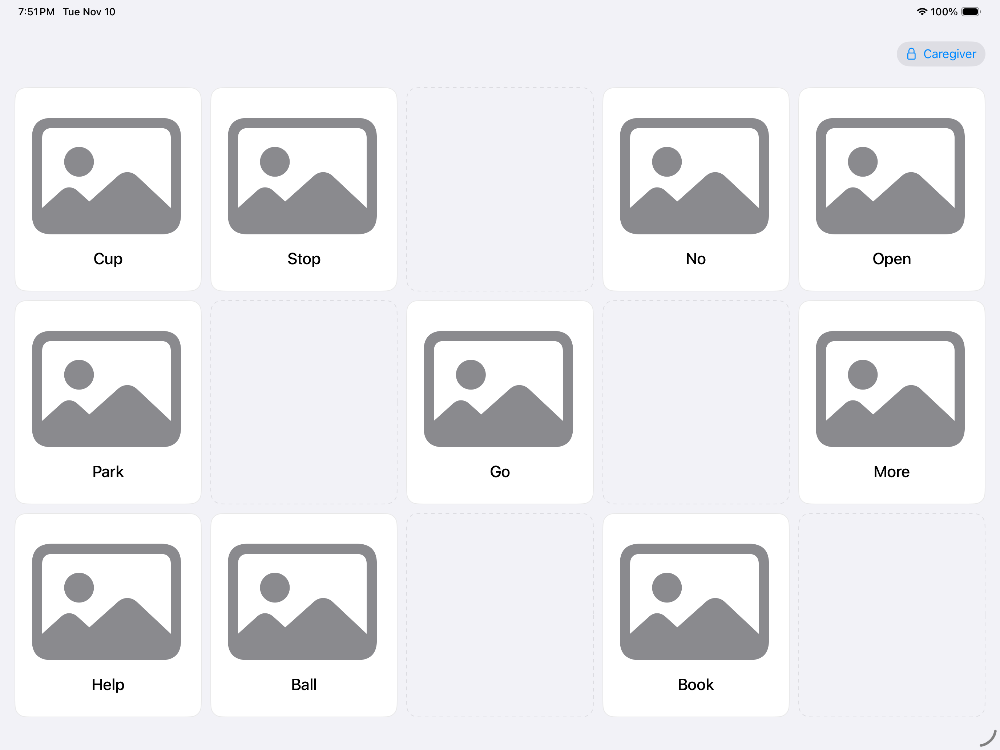

# Talkboard

Talkboard is a parent-built **augmentative and alternative communication (AAC)**
app for iPad. I started building it for my child, bringing together AAC research,
educational practices and practical ideas from everyday caregiving to make a
communication tool we could try and improve together.

The aim is to turn an iPad into a simple, personal communication device: tap a
picture to speak, use familiar photos or symbols, and add vocabulary while keeping
learned button positions stable. The app is built with SwiftUI and works with
local pictures, installed voices and recordings.

**Parents, teachers, caregivers, AAC users, speech-language pathologists and
developers are welcome to contribute.** You do not need to write code. Experiences,
research, corrections, accessibility feedback and ideas from home or classroom
use can all help shape this project. [Join the conversation in an issue](https://github.com/brendanphall/talkboard/issues)
or read [how to contribute](CONTRIBUTING.md).



*Actual app screenshot using the public demonstration board. Gray pictures are
placeholders: caregivers can choose their own photos. No personal board or family
media is shown.*

## Help shape it

You can help even if you cannot install the app or write code. A GitHub account
is needed to submit feedback:

- [Suggest an improvement or share an experience](https://github.com/brendanphall/talkboard/issues/new?template=idea.yml).
- [Report something that went wrong](https://github.com/brendanphall/talkboard/issues/new?template=bug.yml).
- Share research or guidance that could improve a design choice through the idea form.

Useful starting questions: What would make editing easier? What makes it hard to
find a word? What should stay consistent as a board grows? Please use made-up
examples and leave out personal photos, names and records.

To try the app today, you need a Mac and Xcode; see [Build and run](#build-and-run).
There is no one-tap public installation yet.

## What we are trying to put into practice

We are working toward a board that supports asking, refusing, commenting and
personal expression; keeps communication available without rewards or tests;
and can be used by adults modeling communication alongside a child. Familiar
pictures, separate labels and spoken phrases, and stable positions are deliberate
design choices we want to keep testing and improving.

Our starting references include [ASHA's AAC Practice Portal](https://www.asha.org/practice-portal/professional-issues/augmentative-and-alternative-communication/)
and the [NJC Communication Bill of Rights](https://www.asha.org/njc/communication-bill-of-rights/).
We distinguish research findings, professional guidance and our own engineering
choices. This is an attempt to apply and learn from that work, not a claim that
this app has established pedagogical or clinical effectiveness. Contributions
that challenge an assumption or point us toward better evidence are welcome.

**Status:** early development. This repository contains a generic demonstration
board and source code for building the app yourself. There is no App Store
release yet. Export/restore and several physical-device acceptance checks remain
unfinished. Software tests do not establish communication or clinical outcomes.

## What works

- A fixed landscape grid with spare cells, large tap targets and VoiceOver labels.
- Immediate speech using installed Apple voices. A new tap interrupts the previous
  output rather than joining a queue.
- Caregiver editing protected by device-owner authentication. Editing locks again
  on backgrounding or when Guided Access starts; speaking stays accessible.
- Photo selection through the system picker, orientation correction, downsampling
  and local storage. Labels and spoken phrases remain separate.
- Atomic board saves with a previous generation retained and visible recovery
  notices when storage cannot be opened normally.
- Optional local recording playback with saved-text fallback if the file cannot
  be opened or playback cannot start. A recording import/capture UI is not yet built.

The demonstration uses invented labels and placeholder images. Add your own
pictures through **Caregiver → Edit board**. No symbol library, stock photos or
recorded clips are bundled. Imported media keeps its own source/license metadata.

## Build and run

You need macOS, Xcode with Swift 6 support, and [XcodeGen](https://github.com/yonaskolb/XcodeGen).
The deployment target is iPadOS 17 or later; development is tested with Xcode 27.2.

```sh
brew install xcodegen
git clone https://github.com/brendanphall/talkboard.git
cd talkboard
xcodegen generate
open Talkboard.xcodeproj
```

Choose an iPad simulator and run the `Talkboard` scheme. To use a physical iPad,
select your own development team under Signing & Capabilities, choose a unique
bundle identifier, and enable Developer Mode on the device. The repository does
not contain signing credentials or profiles. The default identifier is
`com.brendanphall.talkboard.public`.

On a physical device, caregiver editing requires a configured device passcode.
Try local photos and deliberate tile taps at a comfortable volume. Offline speech
requires an available installed voice. Device signing and distribution expire
according to your Apple account and provisioning profile.

## Tests

Run the platform-independent logic tests:

```sh
swift test --package-path Packages/TalkboardCore
```

Run the native and UI suites with an available iPad simulator:

```sh
xcodegen generate
xcodebuild -showdestinations -project Talkboard.xcodeproj -scheme Talkboard
xcodebuild test -project Talkboard.xcodeproj -scheme Talkboard \
  -destination 'platform=iOS Simulator,name=<your iPad simulator>' \
  -parallel-testing-enabled NO
```

UI automation uses a Debug-only silent output path and isolated demonstration
storage. Test authentication bypasses also require that silent test mode and are
excluded from Release builds. Keep automated tests silent and use invented data.
CI runs the Core package tests on macOS; native/UI acceptance is separate.

## Project layout

| Path | Purpose |
| --- | --- |
| `App/` | SwiftUI views and Apple photo, speech, recording and authentication adapters |
| `Packages/TalkboardCore/` | Board schema, validation, storage, editing and output policy |
| `Tests/` | Native adapter and state tests |
| `UITests/` | Board geometry, caregiver and editor interaction tests |
| `project.yml` | XcodeGen project definition |
| `docs/` | Design contract, privacy notes and picture-packet format |

See [design and limits](docs/DESIGN.md), [privacy](docs/PRIVACY.md),
[picture packet import](docs/PICTURE_PACKETS.md) and [contributing](CONTRIBUTING.md).

## Next steps

Validated export/restore to Files, a printable matching board, more physical-device
acceptance work, and a caregiver interface for importing or recording tile audio.

## License

Copyright 2026 Brendan Hall. Licensed under the [Apache License, Version 2.0](LICENSE).

The code license does not grant rights to photos, symbols or recordings that
users import. Those assets retain their own permissions and attribution.
